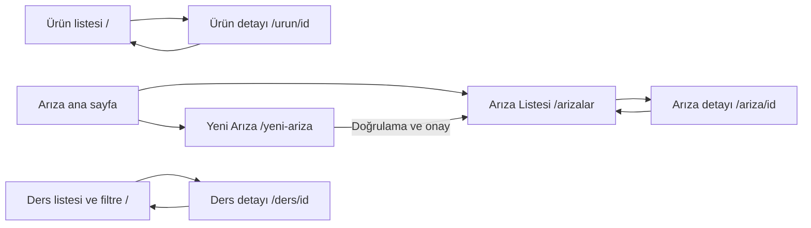

# Kısa değerlendirme ve teslim raporu

Tarih: 27 Ekim 2026  
Ad Soyad / Numara: Öğrenci tarafından doldurulacak.

## Kısa değerlendirme — 7 cümle

Bu çalışmada Arıza Takip, Mini Ürün Kataloğu ve Öğrenci Ders Programı ayrı Expo proje klasörlerinde hazırlandı.
Tekrarlanan kartlar TicketCard, ProductCard ve CourseCard bileşenlerine ayrıldı; durum ve stok gösterimleri de ortak bileşenlere taşındı.
Expo Router Stack ile liste ve detay ekranları arasında gezinme, useLocalSearchParams ile kimliğe göre doğru kaydı seçme sağlandı.
Arıza uygulamasında önceki haftanın form doğrulamaları, acil talep onayı, arama, filtreleme, silme ve durum güncelleme özellikleri korundu.
Bilinmeyen kimliklerde kontrollü uyarı ekranı ve doğrudan detay bağlantılarında listeye dönüş eklendi.
Gün ve ders adı filtresi ile isteğe bağlı üç sekmeli görev uygulaması tamamlandı.
Sonraki geliştirmede, uygulama kapanınca kayıtların korunması için yerel kalıcı depolama ve dersler için hatırlatıcı eklenebilir.

## Öğrenci kısa raporu sorularının teknik karşılıkları

1. **Yeniden kullanılabilir bileşenler:** TicketCard, StatusBadge, TalepFormu, ProductCard, StockBadge, CourseCard, TaskCard; ayrıca Heading, Field, Back, Missing ve Button. Kartlar tek kaydı props üzerinden alır; durum ve gezinme ilgili Context/Router tarafından yönetilir.
2. **Navigasyon işlemleri:** Stack ve Tabs; `router.push` ile detay/yeni form; `router.replace` ile kayıt sonrası liste; `router.back` ile geri dönüş; geçmiş yoksa `router.replace` ile güvenli listeye dönüş. Parametre okuma: `useLocalSearchParams`.
3. **Karşılaşılan hata ve çözümü:** Aşağıdaki doğrulanmış teknik hata kaydı kullanıldı. Bu açıklama AI tarafından yazılmıştır, öğrencinin kişisel deneyimi olarak sunulmaz.
4. **AI kullanımı:** Gereksinim çözümleme, ekran akışı ve bileşen taslağı, kod, testler, hata düzeltme ve bu rapor AI yardımıyla hazırlandı.
5. **Geliştirme önerisi:** AsyncStorage benzeri kalıcı yerel depolama; isteğe göre kullanıcı hesabı ve bildirimler.

## Hata kaydı — sorun / neden / çözüm

**H1 — Tip kontrolünde isteğe bağlı props hatası.** İlk `tsc --noEmit` çalıştırmasında eski `Buton` ve `Secenek` bileşenlerinin simge, etiket ve renk alanları verilmediğinde TS2739/TS2741 hataları oluştu. JavaScript parametre ayrıştırmasında bu alanların isteğe bağlı olduğu belirtilmediğinden kontrol aracı onları zorunlu kabul ediyordu. Bu alanlara `undefined` varsayılanları eklendi; simge adları için Ionicons sözleşmesi tanımlandı. Yeniden çalıştırılan tip kontrolü ve lint geçti; önceki form davranışı korunarak 22 veri/form testi başarılı oldu.

**H2 — Gezinme bağımlılığı uyuşmazlığı.** Expo Router kurulumu geçişli animasyon paketlerinin SDK dışında kalan sürümlerini seçti. `expo install react-native-reanimated react-native-worklets` ile SDK 57'nin uyumlu sürümleri kuruldu. Çevrim içi `expo install --check` sonucu: `Dependencies are up to date`.

## Tasarım kararı ve gerekçesi

Ürün kataloğunda kırık beyaz zemin, koyu yazı ve yeşil vurgu kullanıldı; fiyatın büyük yazılması ve stok etiketinin ayrı tutulması hızlı karşılaştırmayı kolaylaştırır. Stoksuz ürün yalnızca renk ile değil “Stokta yok” metniyle de ayrılır. Ekranlar dar telefonda tek sütun, geniş ekranda en çok 760 piksel içerik genişliği kullanır. Basılabilir alanlar en az 44–48 piksel olarak düzenlendi. Arıza kartlarının önceki haftadan gelen mavi tasarımı korundu; Bekliyor turuncu, İşlemde mavi, Çözüldü yeşildir.

## Ekran akışı ve bileşen ayrımı

Ekranlar gezinme ve veri seçimini, kartlar tek kaydın sunumunu, rozetler durum/stock görünümünü üstlenir. Arıza Context'i form ve kayıtların ekran değişiminde kaybolmasını engeller. Ürün ve ders verileri salt okunur yerel dizilerde, örnek görevler ayrı Context'te tutulur. Föydeki `app/` yolu, proje yönergesine uygun `src/app/` olarak uygulanmıştır; Expo Router aynı dosya tabanlı rota yapısını kullanır.

## Yapay zekâdan nerede yararlandım?

Bu teslimin gereksinim analizi, ekran akışı, bileşen ayrımı, uygulama kodu, otomatik testleri ve raporu Codex yardımıyla hazırlandı. Öğrencinin bu tasarımı bağımsız olarak oluşturduğu veya testleri şahsen yaptığı ileri sürülmemektedir. Öğrenci kodu inceleyip kendi gerekçelerini ve deneyimini eklemelidir.

## Föyün kişisel öğrenci çalışması şartı

Föy AI kullanımını sözdizimi/hata/tek bileşen desteğiyle sınırlar; ekran akışı ile bileşen kararlarını ve en az bir hata açıklamasını öğrenciye bırakır. Kullanıcı isteği doğrultusunda teknik uygulama tamamlanmıştır, ancak bu belge bu kişisel çalışma şartlarının yerine getirildiğinin kanıtı değildir. Öğrencinin kimlik alanını doldurması, akış ve bileşen kararlarını kendisinin değerlendirmesi, gerçekten yaşadığı bir hatayı kendi cümleleriyle anlatması gerekir. AI katkısının kapsamı gizlenmemelidir.

## Başvurulan resmi teknik kaynaklar

- [Expo SDK 57](https://docs.expo.dev/versions/v57.0.0/)
- [Expo Router kurulumu](https://docs.expo.dev/router/installation/)
- [Dinamik rota ve gezinme](https://docs.expo.dev/router/basics/navigation/)
- [JavaScript Tabs](https://docs.expo.dev/router/advanced/tabs/)
